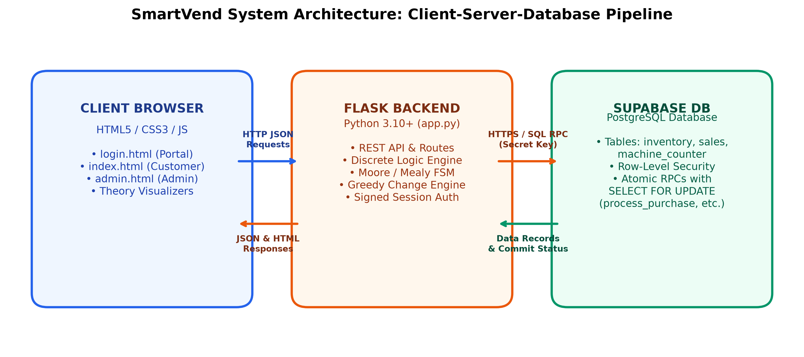
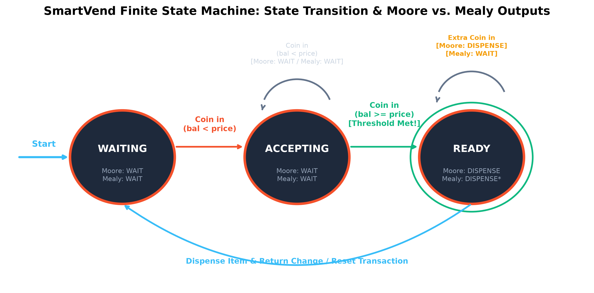

# SmartVend: Complete Course Project Study Guide & Viva Preparation Manual
**Course:** Discrete Structures and Automata / Computational Theory (DSACT)
**Project:** SmartVend — Interactive Discrete Mathematics Vending Simulator
**Tech Stack:** Python Flask, Vanilla HTML5/CSS3/JavaScript, Supabase PostgreSQL
---
## Table of Contents
- 1. Project Overview & System Architecture
- 2. Tech Stack Explained & File-to-Purpose Directory
- 3. Discrete Structures Concepts Used in SmartVend (Units I, II, III, IV & V CFG Engine)
- 4. Finite State Machines (FSM): Moore vs. Mealy Automata & State Diagram
- 5. Propositional Logic: Boolean Gating, Truth Tables & De Morgan's Laws
- 6. Change-Making Algorithm: Greedy Optimization & Canonical Systems
- 7. Database Architecture: Tables, Constraints, Stored Procedures & Concurrency
- 8. Backend API Walkthrough: Request, Response & Execution Logic
- 9. Frontend Architecture: Customer View, Portal & Reactive State
- 10. Complete End-to-End Flow: Full Transaction Trace
- 11. Admin Features: Authentication, Inventory Controls & Daily Sales Collection
- 12. Security and Design Decisions: Secret Key Isolation & Weaknesses
- 13. Limitations and Future Improvements
- 14. Comprehensive Viva Question Bank (45 Questions & Model Answers)
- 15. 5-Minute Presentation Script & Live Demo Guide
- 16. One-Page Revision Cheat Sheet
- 17. Alphabetical Glossary of Technical and Mathematical Terms
- Appendix A: Examiner 'If Asked X, Say Y' Quick Answers
- Appendix B: Demo Day Technical Checklist
---
## 1. Project Overview & System Architecture
SmartVend is a smart vending machine web simulation created specifically as an applied laboratory project for Discrete Mathematics and Computational Theory. While standard e-commerce or vending projects focus purely on UI and CRUD (Create, Read, Update, Delete) operations, SmartVend's primary educational purpose is to bridge theoretical discrete mathematics with industrial-grade transactional software engineering.
The application models physical dispensing authorization through Propositional Logic, classifies and verifies catalog data through Sets and Binary Relations, simulates digital payment control circuits through Moore and Mealy Finite State Machines, and minimizes returned currency count using a Greedy Combinatorial Change-Making Algorithm.
**System Architecture Pipeline:**
1. **Client Browser Layer (Frontend):** Pure HTML5, CSS3, and vanilla JavaScript. Provides a Customer View (/customer) featuring an interactive 6-product vending grid, animated coin insertion slots, cart management, live itemized receipts, and real-time theory visualizer cards. Also provides an Admin View (/admin) for inventory management and end-of-day sales auditing.
2. **Application Server Layer (Flask Backend):** Python 3.10+ Flask micro-framework running `app.py`. Exposes a RESTful API, hosts the FSM simulation engine, computes change breakdowns, and handles session security.
3. **Database Layer (Supabase PostgreSQL):** A cloud relational database storing persistent inventory, sales ledgers, and daily collection counters. Utilizes Row-Level Security (RLS) and PL/pgSQL stored procedures to execute atomic transactions using exclusive row locks (`SELECT FOR UPDATE`), preventing race conditions.

## 2. Tech Stack Explained & File-to-Purpose Directory
**Why Flask?** Flask is a lightweight Python WSGI web framework that provides routing, request parsing, and session management without imposing heavy ORM or boilerplate architecture. It allows algorithmic logic (FSM, logic evaluation, change calculation) to remain transparent and cleanly inspectable.

**Why Supabase & PostgreSQL?** Supabase provides a fully managed PostgreSQL database with native ACID transaction guarantees, stored procedures (PL/pgSQL), and Row-Level Security (RLS). PostgreSQL allows transactional consistency and row-level locking, which is critical for vending machines to avoid negative inventory or race conditions.

**Why Vanilla HTML/CSS/JavaScript?** Modern frontend frameworks (React, Angular, Vue) add significant build complexity and virtual DOM abstraction. Vanilla JavaScript ensures zero build dependencies, instant page load, and direct DOM manipulation that an examiner can easily trace and verify.
### Complete Project File Directory
| File Path | Type | One-Line Purpose |
| :--- | :--- | :--- |
| `app.py` | Python Flask Server | Core web application, REST endpoints, FSM engine, greedy change algorithm, signed session auth. |
| `frontend/login.html` | Portal Page | Landing page directing users to Customer View (/customer) or Admin Sign-in (/admin). |
| `frontend/index.html` | Customer View | Main vending interface with product grid, coin input, cart, itemized receipt, and live Discrete Theory visualizers. |
| `frontend/admin.html` | Admin View | Password-protected administrative panel for real-time inventory adjustments, restocking, and daily sales collection. |
| `schema.sql` | PostgreSQL Schema | PostgreSQL DDL/DML, table constraints, RLS policies, and transactional stored procedures (process_purchase, process_cart_purchase, collect_end_day, reset_machine). |
| `.env` | Environment Config | Secret environment variables: SUPABASE_URL, SUPABASE_SECRET_KEY, SMARTVEND_ADMIN_PASSWORD, SECRET_KEY, PORT (Never committed). |
| `.env.example` | Template Config | Committed template showing placeholder variables required for deployment. |
| `.gitignore` | Git Ignore Rules | Prevents committing .env, venv/, Python cache, and credentials into version control. |
| `requirements.txt` | Dependencies | Lists Python packages: Flask, gunicorn, supabase, python-dotenv. |
| `render.yaml` | Render Blueprint | Deployment blueprint for hosting on Render cloud platform. |
| `README.md` | Documentation | Project overview, architectural overview, feature documentation, and local Windows setup guide. |
## 3. Discrete Structures Concepts Used in SmartVend
SmartVend incorporates five major areas of Discrete Structures and Automata Theory. Below is an exhaustive breakdown of each concept, its mathematical definition, where it lives in the codebase, a worked numerical example, its code snippet with line-by-line explanation, and likely examiner viva questions.
### Propositional Logic (Boolean Gating & Predicates)
**Mathematical Definition:**
Propositional logic is the mathematical branch that studies propositions—declarative statements that possess a definite truth value of either True (1) or False (0), but never both simultaneously. Compound propositions are formed using logical connectives such as Conjunction (AND, symbol ∧), Disjunction (OR, symbol ∨), Negation (NOT, symbol ¬), and Implication (IF-THEN, symbol →).

**Location in Project:** `app.py lines 252-257 (in purchase()), lines 321-326 (in cart_purchase()), frontend/index.html line 57 (in updateLogic())`

**Project Expressions & Symbols:**
- **P**: `paid >= price (or paid >= total)` — Evaluates to True if deposited money is sufficient to cover item or cart cost.
- **Q**: `stock_after >= 0 (or all cart items have stock >= quantity)` — Evaluates to True if item or all requested cart items are physically in stock.
- **P ∧ Q**: `paid >= price AND stock_after >= 0` — Vending Authorization Conjunction: The physical dispense solenoid is energized if and only if both P and Q are True.
- **R**: `stock_after < LOW_STOCK_THRESHOLD (where threshold = 2)` — Inventory Alert Predicate: Evaluates to True when stock falls strictly below 2 units.

**Worked Example with Real Project Values:**
Scenario: Customer selects Slot A3 (Soda, Price ₹25, Stock 6). Customer inserts ₹20 followed by ₹10 (Total paid = ₹30).
1. Evaluate P: 30 >= 25 is True (P = 1).
2. Evaluate Q: Stock is 6, which is > 0; stock_after = 5 >= 0 is True (Q = 1).
3. Evaluate P ∧ Q: True ∧ True = True. The machine authorizes the dispense operation.
4. Evaluate R: stock_after = 5. Check 5 < 2 is False (R = 0). No low-stock warning is triggered.
Counter-scenario: If customer inserts ₹20 for Soda (₹25), P = False, Q = True => P ∧ Q = False. Dispense is rejected with error 'Insufficient balance'.

**Code Snippet:**
```python
logic = {
    'P': paid >= payload['price'],
    'Q': payload['stock_after'] >= 0,
    'P_AND_Q': paid >= payload['price'] and payload['stock_after'] >= 0,
    'R_LOW_STOCK': payload['stock_after'] < LOW_STOCK_THRESHOLD,
}
```

**Line-by-Line Code Explanation:**
Line 1 computes boolean proposition P by evaluating whether the integer sum of coins is greater than or equal to the item's database price.
Line 2 computes proposition Q by verifying that the stock count returned by the database stored procedure is non-negative.
Line 3 computes the conjunction P ∧ Q using Python's logical 'and' operator. This value directly gates whether the dispense output is triggered.
Line 4 evaluates predicate R by checking if remaining stock is strictly less than LOW_STOCK_THRESHOLD (constant = 2).

**Likely Examiner Viva Questions & Answers:**
- **Q: Why did you model the purchase check as Propositional Logic instead of a standard if-statement?**
  *Model Answer:* In computational theory and digital circuit design for embedded vending machines, dispensing hardware is controlled by logic gates (an AND gate combining a coin comparator comparator circuit P and a microswitch/database inventory sensor Q). Modeling it formally as P ∧ Q bridges theoretical discrete logic with real physical hardware and transactional software.

- **Q: What is the truth value of the implication (P ∧ Q) → Dispense if the user inserts insufficient funds?**
  *Model Answer:* When the user inserts insufficient funds, P is False, which makes the antecedent (P ∧ Q) False. In classical propositional logic, a conditional statement with a False antecedent is vacuously True (False → Anything is True). However, the machine's dispensing action is conditioned on the biconditional Dispense ↔ (P ∧ Q), meaning dispensing occurs if and only if both conditions are satisfied.

- **Q: How would you apply De Morgan's Laws to the vending rejection condition?**
  *Model Answer:* The condition to authorize dispense is (P ∧ Q). Dispense is rejected when ¬(P ∧ Q). By De Morgan's First Law, ¬(P ∧ Q) ≡ (¬P ∨ ¬Q). In plain English: 'Dispensing is refused if the customer paid insufficient funds OR the item is out of stock'.

### Sets, Binary Relations, and Functions
**Mathematical Definition:**
A Set is a well-defined collection of distinct objects. A Binary Relation R from set A to set B is a mathematical subset of the Cartesian product A × B (i.e., R ⊆ A × B). A Function f: A → B is a special type of relation where every element a ∈ A is related to exactly one element b ∈ B. Functions can be Injective (one-to-one), Surjective (onto), or Bijective (both one-to-one and onto, hence invertible).

**Location in Project:** `app.py lines 67-83 (sets_relations()), frontend/index.html lines 39, 48, 60`

**Project Expressions & Symbols:**
- **Slots Set (S)**: `{A1, A2, A3, B1, B2, B3}` — Finite set of physical dispensing slots in the vending matrix.
- **Items Set (I)**: `{Water, Juice, Soda, Chips, Cookies, Chocolate}` — Finite set of distinct product names.
- **Prices Set (P)**: `{15, 20, 25, 30}` — Set of valid product prices in Indian Rupees (₹).
- **Categories Set (C)**: `{beverage, snack}` — Partitioning domain for product classification.
- **Stock Set (K)**: `Subset of Non-Negative Integers (K ⊂ Z≥0)` — Quantities currently remaining in each dispenser slot.

**Worked Example with Real Project Values:**
Consider the binary relations defined dynamically in sets_relations():
1. Slot-to-Item Relation R1 ⊆ S × I:
   R1 = {(A1, Water), (A2, Juice), (A3, Soda), (B1, Chips), (B2, Cookies), (B3, Chocolate)}
   Analysis: Every slot has exactly one item, and every item has exactly one slot. R1 is a BIJECTION (one-to-one and onto).
   Therefore, R1 is invertible: R1⁻¹ maps each item back to its unique slot.

2. Item-to-Price Relation R2 ⊆ I × P:
   R2 = {(Water, 20), (Juice, 30), (Soda, 25), (Chips, 20), (Cookies, 15), (Chocolate, 25)}
   Analysis: Every item has a unique price, so R2 is a FUNCTION. However, R2 is NOT INJECTIVE because (Water, 20) and (Chips, 20) share the same price (₹20). R2 is SURJECTIVE because all prices in P are assigned.

3. Composite Relation (R2 ∘ R1) ⊆ S × P (Slot to Price):
   Maps a hardware slot directly to its price: (A1, 20), (A2, 30), (A3, 25), (B1, 20), (B2, 15), (B3, 25).

**Code Snippet:**
```python
def sets_relations():
    rows = inventory_rows()
    return {
        'sets': {
            'slots': sorted(x['slot'] for x in rows),
            'item_names': sorted(x['name'] for x in rows),
            'prices': sorted(set(x['price'] for x in rows)),
            'stock_values': sorted(set(x['stock'] for x in rows)),
            'categories': sorted(set(x['category'] for x in rows)),
        },
        'relations': {
            'slot_to_item': [[x['slot'], x['name']] for x in rows],
            'item_to_price': [[x['name'], x['price']] for x in rows],
            'item_to_stock': [[x['name'], x['stock']] for x in rows],
            'item_to_category': [[x['name'], x['category']] for x in rows],
        },
    }
```

**Line-by-Line Code Explanation:**
Line 2 executes a Supabase query retrieving all active rows from the inventory table.
Lines 5-9 extract discrete mathematical sets using Python set comprehensions to guarantee uniqueness (e.g., set(x['price'] for x in rows) eliminates duplicate prices).
Lines 12-15 construct the binary relations as explicit lists of 2-tuples (ordered pairs) corresponding to subsets of Cartesian products S × I, I × P, I × K, and I × C.

**Likely Examiner Viva Questions & Answers:**
- **Q: Is the Slot-to-Item relation an equivalence relation?**
  *Model Answer:* No. An equivalence relation must be reflexive, symmetric, and transitive, which are properties defined on a relation over a single set A (i.e., R ⊆ A × A). Slot-to-Item is a relation between two completely distinct sets S and I (S × I). An element of S (like 'A1') cannot be related to itself because 'A1' is not an element of I.

- **Q: Why is the Item-to-Price relation a function, but not an injective function?**
  *Model Answer:* It is a function because every item x ∈ I is mapped to exactly one price y ∈ P (deterministic pricing). It is not injective (one-to-one) because distinct domain elements map to the same codomain element: price(Water) = 20 and price(Chips) = 20.

- **Q: How does relation composition work in your database schema?**
  *Model Answer:* When a user selects a slot, the system must determine its price. Mathematically, this is the composition of relations (R2 ∘ R1)(slot) = R2(R1(slot)). In relational database algebra, this composition corresponds exactly to an INNER JOIN or a foreign key lookup between slot, item, and price.

### Finite State Machines: Moore and Mealy Automata
**Mathematical Definition:**
A Finite State Machine (FSM) or Finite Automaton is a mathematical model of computation consisting of a finite set of states, an input alphabet, a transition function, an initial state, and an output function.
• Moore Machine: A 6-tuple (Q, Σ, Δ, δ, λ, q0) where the output λ depends SOLELY on the current state: λ: Q → Δ.
• Mealy Machine: A 6-tuple (Q, Σ, Δ, δ, λ, q0) where the output λ depends on BOTH the current state and the current input: λ: Q × Σ → Δ.

**Location in Project:** `app.py lines 97-121 (in fsm()), lines 215-228 (in compare()), frontend/index.html lines 40, 54-55`

**Project Expressions & Symbols:**
- **States (Q)**: `{WAITING, ACCEPTING, READY}` — Operating states of the vending payment controller.
- **Input Alphabet (Σ)**: `{5, 10, 20, 50}` — Accepted Indian Rupee coin denominations.
- **Output Alphabet (Δ)**: `{WAIT, DISPENSE}` — Hardware control signals issued to the user/solenoid.
- **Initial State (q0)**: `WAITING` — Default state when machine is idle.
- **Transition Function (δ)**: `δ(current_state, coin) → next_state` — State transition based on accumulated balance vs. item price.

**Worked Example with Real Project Values:**
Comparison Trace: Item Price = ₹25. Customer inserts coins [10, 10, 10, 5] (Total ₹35).
----------------------------------------------------------------------------------------------------
Step | Coin | Balance | Moore State | Moore Output | Mealy State | Mealy Output | Explanation
----------------------------------------------------------------------------------------------------
0    | Init | 0       | WAITING     | WAIT         | WAITING     | WAIT         | Initial idle state.
1    | ₹10  | 10      | ACCEPTING   | WAIT         | ACCEPTING   | WAIT         | 10 < 25; continue waiting.
2    | ₹10  | 20      | ACCEPTING   | WAIT         | ACCEPTING   | WAIT         | 20 < 25; continue waiting.
3    | ₹10  | 30      | READY       | DISPENSE     | READY       | DISPENSE     | 30 >= 25! Threshold crossed on this step!
4    | ₹5   | 35      | READY       | DISPENSE     | READY       | WAIT         | CRUCIAL DIFFERENCE!
----------------------------------------------------------------------------------------------------
Why Step 4 is critical:
• In the Moore model, output depends only on state: because state is READY, Moore outputs DISPENSE continuously.
• In the Mealy model, output is tied to the transition edge: because the threshold was ALREADY crossed in Step 3 (prev == 'READY'), inserting an additional coin does NOT trigger a second dispense command; it outputs WAIT. This prevents hardware double-dispensing!

**Code Snippet:**
```python
def fsm(coins, price):
    balance = 0
    rows = []
    moore = 'WAITING'
    mealy = 'WAITING'
    for coin in coins:
        prev = mealy
        if moore == 'WAITING':
            moore = 'ACCEPTING'
        balance += coin
        if balance >= price:
            moore = 'READY'
        if mealy == 'WAITING':
            mealy = 'ACCEPTING'
        threshold = balance >= price and prev != 'READY'
        mealy = 'READY' if balance >= price else 'ACCEPTING'
        rows.append({
            'coin': coin,
            'balance': balance,
            'moore_state': moore,
            'moore_output': 'DISPENSE' if moore == 'READY' else 'WAIT',
            'mealy_state': mealy,
            'mealy_output': 'DISPENSE' if threshold else 'WAIT',
        })
    return rows
```

**Line-by-Line Code Explanation:**
Lines 3-4 initialize both Moore and Mealy automata in state 'WAITING'.
Line 5 iterates deterministically across the chronological array of coin insertions.
Line 6 caches 'prev = mealy' to record the state prior to the current coin transition.
Lines 7-10 update balance and advance Moore state to 'ACCEPTING' or 'READY'.
Line 13 calculates the Mealy threshold predicate: 'threshold = balance >= price and prev != READY'. This boolean condition is True ONLY on the exact edge where balance first meets or exceeds price.
Line 18 generates the Moore output: 'DISPENSE' if moore == 'READY' else 'WAIT'.
Line 20 generates the Mealy output: 'DISPENSE' if threshold else 'WAIT'.

**Likely Examiner Viva Questions & Answers:**
- **Q: Which machine model is safer for a vending machine hardware actuator: Moore or Mealy?**
  *Model Answer:* Mealy machine is safer for dispensing physical actuators. A physical solenoid motor needs an impulse pulse (edge-triggered) to drop exactly one item. A Moore machine produces an active level output as long as the machine remains in the READY state; if the customer inserts another coin or delay occurs, a naive controller could keep the motor running and dispense multiple items. Mealy's edge-sensitive output ensures exactly one DISPENSE pulse.

- **Q: Can any Mealy machine be converted into an equivalent Moore machine?**
  *Model Answer:* Yes. By the State Splitting Theorem, any Mealy machine with n states and m output symbols can be converted into an equivalent Moore machine having at most n × m states. In our case, the READY state would need to be split into READY_JUST_ENTERED (output DISPENSE) and READY_OVERPAID (output WAIT).

- **Q: Is your FSM deterministic or non-deterministic (DFA vs NFA)?**
  *Model Answer:* It is strictly a Deterministic Finite Automaton (DFA). For every state and valid coin input c ∈ {5, 10, 20, 50}, there is exactly one uniquely determined next state. There are no ε-transitions (transitions without input) or ambiguous branches.

### Greedy Change-Making Algorithm & Canonical Systems
**Mathematical Definition:**
The Change-Making Problem is an algorithmic problem in combinatorial optimization: given an integer target amount A and a set of coin denominations D = {d1, d2, ..., dn}, find the minimum number of coins whose sum equals A. A Greedy Algorithm makes the locally optimal choice at each stage with the hope of finding a global optimum. A coin denomination set is called Canonical if the greedy algorithm always produces the optimal (minimum coin count) solution for every possible change amount.

**Location in Project:** `app.py lines 86-94 (in change_breakdown()), schema.sql line 97`

**Project Expressions & Symbols:**
- **Denominations Set (D)**: `{50, 20, 10, 5}` — Accepted coins sorted in strictly descending order.
- **Objective Function**: `Minimize Σ ci subject to Σ (ci × di) = Change` — Minimum total coin count.
- **Remainder Invariant**: `amount_remaining < current_denomination` — Greedy choice property.

**Worked Example with Real Project Values:**
Worked Example 1: Change = ₹35
• Step 1: 35 < 50 (skip ₹50)
• Step 2: 35 >= 20 => Select ₹20. Remaining change = 35 - 20 = ₹15.
• Step 3: 15 >= 10 => Select ₹10. Remaining change = 15 - 10 = ₹5.
• Step 4: 5 >= 5   => Select ₹5.  Remaining change = 5 - 5 = ₹0.
Result: [20, 10, 5] (Total 3 coins). Optimal.

Worked Example 2: Change = ₹70
• Step 1: 70 >= 50 => Select ₹50. Remaining = 70 - 50 = ₹20.
• Step 2: 20 >= 20 => Select ₹20. Remaining = 20 - 20 = ₹0.
Result: [50, 20] (Total 2 coins). Optimal.

Worked Example 3: Change = ₹15
• Step 1: 15 >= 10 => Select ₹10. Remaining = 15 - 10 = ₹5.
• Step 2: 5 >= 5   => Select ₹5.  Remaining = 5 - 5 = ₹0.
Result: [10, 5] (Total 2 coins). Optimal.

**Code Snippet:**
```python
def change_breakdown(amount):
    result = []
    for d in sorted(DENOMINATIONS, reverse=True):
        while amount >= d:
            result.append(d)
            amount -= d
    if amount:
        raise ValueError('Exact change cannot be represented.')
    return result
```

**Line-by-Line Code Explanation:**
Line 2 sorts DENOMINATIONS = [5, 10, 20, 50] in reverse order: [50, 20, 10, 5].
Lines 3-5 iteratively subtract the largest possible denomination d from amount as long as amount >= d, appending d to the result list.
Lines 6-7 check the invariant that amount must reach exactly 0. If amount > 0 (e.g. if ₹3 was requested), it raises a ValueError indicating change cannot be given with available denominations.

**Likely Examiner Viva Questions & Answers:**
- **Q: Is the greedy change-making algorithm always optimal for ANY set of coin denominations?**
  *Model Answer:* No! The greedy algorithm is NOT universally optimal for arbitrary coin sets. For example, consider denominations {50, 40, 10} and target change ₹80. The greedy algorithm chooses 50, then 10, 10, 10 (4 coins). But the optimal solution is 40 + 40 (only 2 coins)! For non-canonical systems, Dynamic Programming (unbounded knapsack) must be used.

- **Q: Why is your coin system {50, 20, 10, 5} canonical?**
  *Model Answer:* Dividing all denominations by the greatest common divisor (5) yields the normalized system {10, 4, 2, 1}. By the Chang-Gill and Pearson canonical coin tests, because each denomination is at least double the previous and pairs satisfy the optimality boundary criteria, the greedy choice property holds for all integer multiples of 5.

- **Q: What is the time and space complexity of your change_breakdown function?**
  *Model Answer:* Time Complexity: O(k) where k is the number of coins returned, or O(1) in terms of input size since the number of denominations is fixed at 4. Space Complexity: O(k) to store the returned coin list.


### Context-Free Grammars & Chomsky Normal Form (Unit V — Pricing Rules Engine)

**Mathematical Definition:**
A Context-Free Grammar (CFG) is a formal 4-tuple:
$$G = (V, \Sigma, R, S)$$
where:
1. **$V$ (Variables / Nonterminals):** A finite set of nonterminal symbols that can be expanded. In SmartVend: $V = \{Deal, Combo, Combo2\}$.
2. **$\Sigma$ (Terminals):** A finite set of terminal symbols disjoint from $V$, representing actual tokens. In SmartVend: $\Sigma = \{snack, beverage\}$.
3. **$R$ (Production Rules):** A finite relation mapping a single nonterminal to a string of variables and terminals: $R \subseteq V \times (V \cup \Sigma)^*$. Each rule has the form $A \to \alpha$.
4. **$S$ (Start Symbol):** The distinguished starting nonterminal: $S = Deal \in V$.

The language generated by grammar $G$ is the set of all terminal strings that can be derived from the start symbol:
$$L(G) = \{w \in \Sigma^* \mid S \Rightarrow^* w\}$$

**Location in Project:** 
- `cfg_engine.py`: Full CFG normalization, CYK parsing, tree unwrapping, derivation generation, and ambiguity detection (`evaluate()`, `normalize()`, `cyk_parse()`, `unwrap_cnf_tree()`).
- `combo_cfg.py`: Re-export adapter.
- `app.py`: `combo_analysis()` (lines 80-142), `/api/combo-config`, `/api/combo-cnf-steps`, `/api/combo-preview`, `/api/cart-purchase`.
- `frontend/index.html`: Unit V CYK parser visualization panel, parse tree viewer, and leftmost derivation display.
- `frontend/admin.html`: CFG deal editor, discount manager, and CNF normalization pipeline visualizer.

**Pricing Rules Engine vs. Input Validator:**
It is critical to note that SmartVend uses the CFG as a **pricing rules engine**, NOT as a transaction validator:
- If the cart's category sequence belongs to the language $w \in L(G)$, the customer receives the promotional combo discount.
- If the cart's category sequence is NOT in the language $w \notin L(G)$ (e.g. two snacks `[snack, snack]`), checkout proceeds normally at regular price without errors or rejection.

**Shipped Starting Grammar:**
```text
Deal  -> Combo | Combo Deal
Combo -> snack beverage | snack snack beverage | beverage Combo2
Combo2 -> snack
```
Product category mapping:
- `beverage`: Water (Slot A1, ₹20), Juice (Slot A2, ₹30), Soda (Slot A3, ₹25)
- `snack`: Chips (Slot B1, ₹20), Cookies (Slot B2, ₹15), Chocolate (Slot B3, ₹25)

**Chomsky Normal Form (CNF) & 4-Stage Normalization Pipeline:**
To allow efficient polynomial-time recognition via the Cocke-Younger-Kasami (CYK) algorithm, any arbitrary context-free grammar must be converted into Chomsky Normal Form (CNF). In CNF, all production rules must strictly adhere to one of two shapes:
1. $A \to B C$ (binary rule: exactly two nonterminals on the RHS)
2. $A \to a$ (unary terminal rule: exactly one terminal symbol on the RHS)

When the admin edits the grammar, SmartVend executes an automated 4-stage normalization pipeline:
1. **Stage 1 — Elimination of $\varepsilon$-productions ($A \to \varepsilon$):**
   - Finds the set of all nullable symbols $\{A \in V \mid A \Rightarrow^* \varepsilon\}$.
   - For every production containing nullable symbols, generates all combinations with and without those symbols.
   - Removes empty productions $\varepsilon$.
2. **Stage 2 — Elimination of Unit Productions ($A \to B$ where $A, B \in V$):**
   - For each nonterminal $A$, computes the unit closure: $Unit(A) = \{B \in V \mid A \Rightarrow^* B\}$.
   - For every non-unit production $B \to \alpha$, adds $A \to \alpha$ directly to $A$'s productions.
   - Deletes all single-variable rules $A \to B$.
3. **Stage 3 — Elimination of Useless Symbols:**
   - *Generating Symbols:* Bottom-up discovery of symbols that can derive a terminal string ($A \Rightarrow^* w, w \in \Sigma^*$). Non-generating symbols and rules referencing them are purged.
   - *Reachable Symbols:* Top-down graph reachability from start symbol $Deal$. Any symbol not reachable from $Deal$ is purged.
4. **Stage 4 — Chomsky Normal Form Binarization & Terminal Isolation:**
   - For terminals appearing in mixed or long rules, synthetic terminal variables are created: $T_{snack} \to snack$, $T_{beverage} \to beverage$.
   - Long rules with $\ge 3$ symbols ($A \to X_1 X_2 \dots X_k$) are broken down into binary cascades: $A \to X_1 BIN_1$, $BIN_1 \to X_2 BIN_2, \dots$.

**Cocke-Younger-Kasami (CYK) Dynamic Programming Algorithm:**
The CYK algorithm tests whether a token string $w = a_1 a_2 \dots a_n$ of length $n$ can be derived by a CNF grammar in $O(n^3 \cdot |R|)$ time:
- A triangular 2D dynamic programming table $V[l, i]$ is constructed, where $V[l, i]$ stores the set of nonterminals that derive the substring of length $l$ starting at index $i$.
- **Base Case ($l = 1$):** $V[1, i] = \{A \in V \mid A \to a_i \in R\}$.
- **Inductive Step ($l = 2$ to $n$):** Substring from $i$ of length $l$ is partitioned into two non-empty segments of length $k$ and $l - k$ for $k = 1, \dots, l - 1$.
  $$V[l, i] = \{A \in V \mid A \to B C \in R, B \in V[k, i], C \in V[l - k, i + k]\}$$
- If $Deal \in V[n, 1]$, the input is accepted ($w \in L(G)$). Back-pointers reconstruct all parse trees.

**Grammar Ambiguity, Detection, and Resolution Policy:**
A grammar is ambiguous if any string in its language has two or more distinct leftmost derivations (or parse trees).
In a pricing engine, ambiguity is critical: if Tree 1 assigns a 10% discount and Tree 2 assigns a 25% discount, the price is indeterminate!
- **Detection:** During CYK back-tracking, SmartVend counts and enumerates all parse trees (`parse_count`). If multiple parse trees yield differing discount rates, `ambiguous = True`.
- **Shipped Default Fix:** The shipped grammar is designed to be unambiguous: `Combo2 -> snack` completes the specification, and `Deal -> Combo | Combo Deal` is right-linear, guaranteeing exactly 1 parse tree for all valid cart combinations.
- **Best-Discount Policy:** If an admin enters an ambiguous grammar with conflicting discounts (e.g. `Deal -> snack DealA | DealB beverage` where DealA gives 10% and DealB gives 25%), the pricing engine resolves ambiguity by applying the **Best-Discount Policy**: the customer is awarded the maximum discount rate ($max(\{10\%, 25\%\}) = 25\%$), preventing customer checkout errors while alerting the admin.

**Worked Numerical Examples:**
- *Example 1 (Single Combo):* Cart has Chips (snack, ₹20) and Water (beverage, ₹20). Subtotal: ₹40. Token sequence: `[snack, beverage]`. Matches `Combo -> snack beverage` (10% discount). Discount amount = $40 \times 10 / 100 = ₹4$. Customer pays ₹36. Leftmost derivation: $Deal \Rightarrow Combo \Rightarrow snack \ beverage$.
- *Example 2 (Higher Discount Combo):* Cart has 2 Chips (snack, snack, ₹40) and Juice (beverage, ₹30). Subtotal: ₹70. Token sequence: `[snack, snack, beverage]`. Matches `Combo -> snack snack beverage` (15% discount). Discount amount = $70 \times 15 / 100 = ₹10$. Customer pays ₹60.
- *Example 3 (Chained Combos):* Cart has `[snack, beverage, beverage, snack]`. Subtotal: ₹85. Matches $Deal \Rightarrow Combo \ Deal \Rightarrow (snack \ beverage) \ (beverage \ Combo2) \Rightarrow snack \ beverage \ beverage \ snack$. Discount: 10% (₹8). Customer pays ₹77.
- *Example 4 (Non-matching Cart):* Cart has 2 Chips `[snack, snack]`. Subtotal: ₹40. CYK finds no derivation from `Deal`. Matched: False. Discount: ₹0. Customer pays ₹40 normally.

**Code Snippet (`cfg_engine.py`):**
```python
def evaluate(sequence, source, discounts=None, categories=None, policy="best-discount"):
    tokens = [str(t).lower() for t in sequence]
    parsed = parse_rules(source, categories)
    cnf, terminals, binaries, stages, intermediates = normalize(parsed, categories)
    trees = cyk_parse(tokens, terminals, binaries, start_symbol="Deal", max_trees=100)
    
    if not trees:
        return {"matched": False, "discount_percent": 0, "total": 0, "tree": None}
    
    unwrapped_trees = [unwrap_cnf_tree(t, parsed) for t in trees]
    tree_discounts = [calculate_discount_for_tree(ut, discounts) for ut in unwrapped_trees]
    distinct = sorted(list(set(tree_discounts)))
    is_ambiguous = len(trees) > 1 and len(distinct) > 1
    
    # Best-Discount Resolution Policy
    selected_discount = max(distinct) if policy == "best-discount" else tree_discounts[0]
    best_idx = tree_discounts.index(selected_discount)
    selected_tree = unwrapped_trees[best_idx]
    
    derivation_steps = generate_leftmost_derivation(selected_tree)
    return {
        "matched": True, "ambiguous": is_ambiguous, "parse_count": len(trees),
        "discount_percent": selected_discount, "tree": serialize_tree(selected_tree),
        "derivation": derivation_steps, "normalization_steps": stages,
        "intermediate_grammars": intermediates,
    }
```

**Likely Examiner Viva Questions & Answers (Unit V):**
- **Q1: What is a Context-Free Grammar, and why is it called "context-free"?**
  *Model Answer:* A CFG is a formal grammar where every production rule has the form $A \to \alpha$, where $A$ is a single nonterminal and $\alpha$ is any string of terminals and nonterminals. It is called "context-free" because the replacement of $A$ with $\alpha$ can be made regardless of what symbols surround $A$ (no left or right context is required, unlike Context-Sensitive Grammars).

- **Q2: Why did you convert the grammar into Chomsky Normal Form (CNF)?**
  *Model Answer:* The Cocke-Younger-Kasami (CYK) algorithm requires the grammar to be in CNF (productions strictly of form $A \to B C$ or $A \to a$). In CNF, every reduction step in dynamic programming splits a substring into exactly two parts or matches a single terminal, which enables the $O(n^3)$ dynamic programming tabular solution.

- **Q3: What are the four stages of CNF normalization in your engine?**
  *Model Answer:* First, eliminate $\varepsilon$-productions by identifying nullable nonterminals. Second, eliminate unit productions ($A \to B$) by computing unit closures. Third, eliminate useless symbols (non-generating symbols bottom-up and unreachable symbols top-down). Fourth, binarize long rules with synthetic variables ($A \to X_1 BIN_1$) and isolate terminals into unary productions ($T_a \to a$).

- **Q4: What is grammar ambiguity, and why is it dangerous in an e-commerce pricing engine?**
  *Model Answer:* A grammar is ambiguous if a string has more than one valid parse tree or leftmost derivation. In a compiler, ambiguity can lead to indeterminate execution semantics. In our pricing engine, if Tree 1 evaluates to a 10% discount and Tree 2 evaluates to a 25% discount, the customer's purchase total is ambiguous. SmartVend detects this via CYK tree enumeration and resolves it using a clear "Best-Discount" policy.

- **Q5: What is the time complexity of your CYK parser?**
  *Model Answer:* The time complexity is $O(n^3 \cdot |R|)$, where $n$ is the number of items in the cart and $|R|$ is the number of production rules in the CNF grammar. Space complexity is $O(n^2 \cdot |V|)$ for the DP recognition table. For a vending machine cart ($n \le 20$), CYK executes in less than 2 milliseconds.

- **Q6: Why did you implement combo deals as a pricing engine rather than an input validator?**
  *Model Answer:* In real vending machines and e-commerce stores, customers should never be blocked from buying products just because their cart does not qualify for a promotion. If a customer buys two bags of Chips, the sequence `[snack, snack]` is not in $L(G)$. Rather than crashing or rejecting the sale, the engine returns `matched: False`, charges full price, and dispenses the items normally.

- **Q7: How did you fix the incomplete sketch and ambiguity in the original specification?**
  *Model Answer:* In the original sketch, `Combo2` was undefined and `Deal -> Combo | Combo Deal` was incomplete. We completed `Combo2 -> snack` so that `beverage Combo2` cleanly derives `beverage snack`. Furthermore, by making `Deal -> Combo | Combo Deal` right-linear rather than `Deal -> Deal Deal | Combo`, we eliminated structural ambiguity, making the default grammar provably unambiguous.

- **Q8: How does your UI show the derivation in the original human-readable grammar rather than the CNF grammar?**
  *Model Answer:* After CYK finds the parse tree in terms of synthetic CNF variables ($T_{snack}, BIN_1$), our `unwrap_cnf_tree()` function recursively collapses synthetic binarization nodes and replaces synthetic terminal variables with their original terminals. Then `generate_leftmost_derivation()` tracks the sentential forms step-by-step from $Deal$ down to the terminal tokens ($Deal \Rightarrow Combo \Rightarrow snack \ beverage$).


## 4. Finite State Machines (FSM): Moore vs. Mealy Automata
A Finite State Machine (FSM) is an abstract computational model consisting of a finite set of states, inputs, outputs, and transition rules. In SmartVend, the payment process is governed simultaneously by both a Moore machine and a Mealy machine in `app.py` inside the function `fsm(coins, price)`.
### Formal 6-Tuple Definition: M = (Q, Σ, Δ, δ, λ, q0)
• **Q (Set of States):** {WAITING, ACCEPTING, READY}
• **Σ (Input Alphabet):** {5, 10, 20, 50} (and product selection / reset events)
• **Δ (Output Alphabet):** {WAIT, DISPENSE}
• **q0 (Initial State):** WAITING
• **δ (Transition Function):** δ: Q × Σ → Q
• **λ (Output Function):**
  - Moore Output Function: λ_Moore: Q → Δ (Depends strictly on current state)
  - Mealy Output Function: λ_Mealy: Q × Σ → Δ (Depends on state transition edge)
### State Transition Table
| Current State | Input / Condition | Next State | Moore Output | Mealy Output | Architectural Explanation |
| :--- | :--- | :--- | :--- | :--- | :--- |
| WAITING | Coin Inserted (Balance < Price) | ACCEPTING | WAIT | WAIT | Initial coin inserted; balance insufficient. |
| ACCEPTING | Coin Inserted (Balance < Price) | ACCEPTING | WAIT | WAIT | Additional coin inserted; still below price threshold. |
| ACCEPTING | Coin Inserted (Balance ≥ Price) | READY | DISPENSE | DISPENSE | Threshold reached! Both models authorize vending. |
| READY | Extra Coin Inserted | READY | DISPENSE | **WAIT** | **CRITICAL DIFFERENCE:** Mealy suppresses double dispense! |
| READY | Dispense Completed / Reset | WAITING | WAIT | WAIT | Machine resets to idle waiting state. |

**The Critical Real-World Difference:**
Notice the fourth row: when the machine is ALREADY in the `READY` state and the customer inserts an extra coin, the Moore machine continues to output `DISPENSE` because its output is tied strictly to being in the `READY` state. If connected directly to a motor solenoid, a Moore machine would keep the motor running and drop multiple items! In contrast, the Mealy machine evaluates `threshold = balance >= price and prev != 'READY'`. Because `prev == 'READY'`, the condition is False and the Mealy machine outputs `WAIT`. This edge-triggered behavior guarantees exactly one dispense pulse!

## 5. Propositional Logic: Boolean Gating, Truth Tables & De Morgan's Laws
In SmartVend, physical item dispensing is protected by a logical AND gate (conjunction). Let $P$ represent the solvency proposition and $Q$ represent physical availability:
- $P \equiv (\text{Paid} \ge \text{Price})$
- $Q \equiv (\text{Stock} > 0) \text{ or } (\text{Stock\_After} \ge 0)$
- $\text{Dispense Authorization} \iff P \land Q$
- $R \equiv (\text{Stock\_After} < 2)$ (Low-Stock Alert Predicate)
### Truth Table for Dispense Authorization
| P (Paid ≥ Price) | Q (Stock Available) | P ∧ Q (Authorize Dispense) | Physical Machine Action | API Status Code |
| :--- | :--- | :--- | :--- | :--- |
| True (1) | True (1) | **True (1)** | Solenoid unlocks; item drops; change returned | 200 OK |
| True (1) | False (0) | **False (0)** | Solenoid locked; refund coins; error displayed | 400 Bad Request ('Out of stock') |
| False (0) | True (1) | **False (0)** | Solenoid locked; machine remains in ACCEPTING | 400 Bad Request ('Insufficient balance') |
| False (0) | False (0) | **False (0)** | Solenoid locked; transaction rejected | 400 Bad Request ('Out of stock') |

**De Morgan's Laws Application:**
The condition for rejecting a purchase is the negation of authorization: $\neg (P \land Q)$.
By De Morgan's First Law: $\neg (P \land Q) \equiv \neg P \lor \neg Q$.
This proves that dispensing fails if the customer paid insufficiently ($\neg P$) OR if the item is out of stock ($\neg Q$).
## 6. Change-Making Algorithm: Greedy Optimization & Canonical Systems
SmartVend uses a Greedy Algorithm in `change_breakdown(amount)` to calculate change. At every step, the algorithm selects the largest coin denomination $d \in \{50, 20, 10, 5\}$ such that $d \le \text{amount}$.
**Three Detailed Worked Examples:**
1. **Change = ₹35:**
   - $35 < 50$ (skip ₹50)
   - $35 \ge 20 \implies$ pick ₹20, remainder = $35 - 20 = ₹15$
   - $15 \ge 10 \implies$ pick ₹10, remainder = $15 - 10 = ₹5$
   - $5 \ge 5 \implies$ pick ₹5, remainder = $5 - 5 = ₹0$
   - *Result:* `[20, 10, 5]` (3 coins). Optimal.

2. **Change = ₹70:**
   - $70 \ge 50 \implies$ pick ₹50, remainder = $70 - 50 = ₹20$
   - $20 \ge 20 \implies$ pick ₹20, remainder = $20 - 20 = ₹0$
   - *Result:* `[50, 20]` (2 coins). Optimal.

3. **Change = ₹15:**
   - $15 \ge 10 \implies$ pick ₹10, remainder = $15 - 10 = ₹5$
   - $5 \ge 5 \implies$ pick ₹5, remainder = $5 - 5 = ₹0$
   - *Result:* `[10, 5]` (2 coins). Optimal.
**Canonical Coin System Proof & Non-Canonical Counterexample:**
A coin system is Canonical if the greedy algorithm always produces the minimum number of coins for every target amount. The denomination set $\{50, 20, 10, 5\}$ is canonical because dividing by the GCD (5) yields $\{10, 4, 2, 1\}$, which satisfies the Chang-Gill and Pearson criteria.

*Counterexample where Greedy Fails:* Suppose the vending machine accepted denominations $\{50, 40, 10\}$ and needed to give ₹80 change:
• Greedy Choice: $50 + 10 + 10 + 10 = 4$ coins.
• Optimal Choice: $40 + 40 = 2$ coins!
This illustrates why coin system design is a fundamental discrete optimization problem.
## 7. Database Architecture: Tables, Constraints, Stored Procedures & Concurrency
SmartVend uses Supabase PostgreSQL (`schema.sql`). All database operations execute through server-side stored procedures in PL/pgSQL using the privileged backend secret key.
### Database Tables & Schema Constraints
### Table: `inventory`
**Purpose:** Stores available vending slots, product metadata, pricing, stock levels, and category icons.
**Constraints:** PRIMARY KEY (slot), CHECK (price > 0), CHECK (stock >= 0), RLS ENABLED (public anon revoked).
| Column Name | SQL Type & Constraints | Description |
| :--- | :--- | :--- |
| `slot` | `TEXT PRIMARY KEY` | Hardware dispenser code ('A1', 'A2', 'A3', 'B1', 'B2', 'B3'). |
| `name` | `TEXT NOT NULL` | Item display name (e.g., 'Water', 'Juice', 'Soda'). |
| `price` | `INTEGER NOT NULL CHECK (price > 0)` | Item price in ₹; enforced strictly positive. |
| `stock` | `INTEGER NOT NULL DEFAULT 0 CHECK (stock >= 0)` | Physical stock count; database-level check prevents negative inventory. |
| `category` | `TEXT NOT NULL` | Product classification ('beverage' or 'snack'). |
| `icon` | `TEXT` | Emoji visual indicator (💧, 🧃, 🥤, 🍟, 🍪, 🍫). |
### Table: `sales`
**Purpose:** Append-only transaction ledger storing each individual item purchase for daily accounting.
**Constraints:** PRIMARY KEY (id), INDEX on sale_time, INDEX on transaction_id, RLS ENABLED.
| Column Name | SQL Type & Constraints | Description |
| :--- | :--- | :--- |
| `id` | `BIGINT GENERATED BY DEFAULT AS IDENTITY PRIMARY KEY` | Unique auto-incrementing transaction sequence ID. |
| `sale_time` | `TIMESTAMPTZ NOT NULL DEFAULT NOW()` | Timestamp of sale with timezone. |
| `slot` | `TEXT NOT NULL` | Dispenser slot purchased. |
| `item_name` | `TEXT NOT NULL` | Snapshot of item name at time of sale. |
| `price` | `INTEGER NOT NULL` | Price paid for the item. |
| `paid` | `INTEGER NOT NULL` | Total money inserted by customer. |
| `change_amount` | `INTEGER NOT NULL` | Change refunded to customer. |
| `transaction_id` | `TEXT NOT NULL` | UUID linking items purchased in the same cart checkout. |
### Table: `machine_counter`
**Purpose:** Singleton table tracking the cumulative count of end-of-day cash collections.
**Constraints:** PRIMARY KEY (id), CHECK (id = 1), RLS ENABLED.
| Column Name | SQL Type & Constraints | Description |
| :--- | :--- | :--- |
| `id` | `INTEGER PRIMARY KEY CHECK (id = 1)` | Singleton lock constraint; guarantees exactly one row exists in table. |
| `receipt_count` | `INTEGER NOT NULL DEFAULT 0` | Monotonically increasing counter of collections performed. |
| `last_receipt_date` | `DATE` | Calendar date on which the last collection receipt was generated. |
### PL/pgSQL Stored Procedures Step-by-Step
### Procedure: `process_purchase(p_slot, p_paid, p_transaction_id)` → Returns `JSONB`
**Why this logic lives in the database:** Atomic transaction: Prevents race conditions. If two users click 'Buy' simultaneously on the last item, FOR UPDATE forces them to execute sequentially. The second user receives an 'out of stock' error instead of corrupting inventory into negative numbers.

**Execution Steps:**
- 1. Row Locking: Executes 'SELECT * INTO v_item FROM inventory WHERE slot = upper(p_slot) FOR UPDATE;'. This places an exclusive row-level lock on the product row, preventing race conditions.
- 2. Existence Check: If no row is returned, aborts and returns '{"success": false, "error": "Unknown slot."}'.
- 3. Stock Verification: Checks if 'v_item.stock <= 0'. If empty, aborts and returns 'Item is out of stock.'
- 4. Solvency Verification: Checks if 'p_paid < v_item.price'. If deficient, aborts and returns 'Insufficient balance'.
- 5. Change Calculation: Computes 'v_change := p_paid - v_item.price'.
- 6. Inventory Decrement: Executes 'UPDATE inventory SET stock = stock - 1 WHERE slot = v_item.slot'.
- 7. Sales Audit Log: Executes 'INSERT INTO sales(slot, item_name, price, paid, change_amount, transaction_id) VALUES (...)'.
- 8. Commit Return: Returns JSONB object containing success status, slot, item name, price, stock_after, and change.
### Procedure: `process_cart_purchase(p_cart, p_paid, p_transaction_id)` → Returns `JSONB`
**Why this logic lives in the database:** All-or-Nothing ACID guarantee: A user buying Water and Cookies will never have Water dispensed while Cookies fail due to stock depletion. Both succeed together or the entire cart purchase rolls back.

**Execution Steps:**
- 1. Cart Validation: Checks that p_cart JSONB array is non-empty and all requested quantities > 0.
- 2. Pre-Validation & Exclusive Locking Pass: Iterates through each cart item and executes 'SELECT * FROM inventory WHERE slot = v_slot FOR UPDATE'. Checks if available stock >= requested quantity. Accumulates total price.
- 3. Insufficient Funds Check: Verifies that p_paid >= total price. If not, aborts entire transaction.
- 4. Execution & Decrement Pass: Updates stock for each slot ('stock = stock - v_qty').
- 5. Sales Logging: Inserts individual rows into sales ledger for each unit purchased, tagged with transaction_id.
- 6. Commit: Returns JSONB array of purchased items, updated stock levels, total, and change.
### Procedure: `collect_end_day(p_day)` → Returns `JSONB`
**Why this logic lives in the database:** Atomicity between summarization and deletion: Guarantees that sales data is never cleared unless the counter was successfully incremented and the financial receipt returned.

**Execution Steps:**
- 1. Summarization: Queries sales table between local start and end of day: counts transactions, sums total sales, cash received, and change dispensed.
- 2. Empty Check: If count = 0, returns error 'No sales recorded today.'
- 3. Product Breakdown: Aggregates item names and quantities sold via jsonb_agg().
- 4. Counter Increment: Locks machine_counter row (FOR UPDATE) and increments receipt_count := receipt_count + 1.
- 5. Ledger Purge: Executes 'DELETE FROM sales WHERE sale_time >= day_start AND sale_time < day_end'.
- 6. State Update: Updates machine_counter with new receipt_count and last_receipt_date = p_day.
- 7. Receipt Formatting: Constructs and returns formatted ASCII receipt array.
### Procedure: `reset_machine()` → Returns `JSONB`
**Why this logic lives in the database:** Clean demonstration reset: Allows resetting test data during viva review without recreating the Supabase PostgreSQL database.

**Execution Steps:**
- 1. Truncates sales table ('DELETE FROM sales;').
- 2. Truncates inventory table ('DELETE FROM inventory;').
- 3. Seeds default 6 products with full initial stock (Water, Juice, Soda, Chips, Cookies, Chocolate).
- 4. Resets machine_counter back to receipt_count = 0, last_receipt_date = NULL.
- 5. Returns '{"success": true}'.

**Concurrency & Race Condition Prevention (`SELECT FOR UPDATE`):**
In a real vending machine or web application, two customers might attempt to buy the last remaining item (stock = 1) at the exact same millisecond. In a naive system without database locks, both queries read `stock = 1`, both approve the purchase, and the stock is decremented twice to $-1$, violating physical reality. SmartVend prevents this by executing `SELECT * INTO v_item FROM inventory WHERE slot = upper(p_slot) FOR UPDATE;`. This acquires an exclusive row-level lock in PostgreSQL. The second transaction must wait until the first commits. When the second transaction executes, it reads `stock = 0`, sees `v_item.stock <= 0`, and cleanly rejects the request with 'Item is out of stock'.
## 8. Backend API Walkthrough: REST Endpoints & Logic Flow
SmartVend exposes 17 HTTP routes in `app.py`. Below is the complete API reference:
| Method | Route | Handler | Access | Request Payload | Response | Description |
| :--- | :--- | :--- | :--- | :--- | :--- | :--- |
| **GET** | `/` | `index()` | Public | `None` | `HTML (login.html)` | Serves portal welcome landing page. |
| **GET** | `/customer` | `customer()` | Public | `None` | `HTML (index.html)` | Serves customer vending machine UI with real-time discrete math theory visualizers. |
| **GET** | `/admin` | `admin()` | Public | `None` | `HTML (admin.html)` | Serves administrative portal for inventory and sales accounting. |
| **GET** | `/api/health` | `health()` | Public | `None` | `{"ok": true, "database": "..."}` | Queries Supabase machine_counter table to verify end-to-end database connectivity. |
| **GET** | `/api/inventory` | `get_inventory()` | Public | `None` | `{"items": [...], "accepted_denominations": [5,10,20,50], ...}` | Fetches live product catalog and stock levels ordered by slot from Supabase inventory table. |
| **GET** | `/api/sets-relations` | `get_sets_relations()` | Public | `None` | `{"sets": {...}, "relations": {...}}` | Dynamically calculates mathematical sets (slots, items, prices, categories, stock) and binary relations from live inventory. |
| **GET** | `/api/access-status` | `access_status()` | Public | `None` | `{"inventory_unlocked": bool, "receipt_unlocked": bool, ...}` | Returns Flask session authorization flags and machine receipt counters. |
| **POST** | `/api/unlock` | `unlock()` | Public | `{"password": str, "target": "inventory"|"receipt"|"both"}` | `{"success": true, ...}` | Validates password against SMARTVEND_ADMIN_PASSWORD and sets signed session cookie flags. |
| **POST** | `/api/lock` | `lock()` | Session | `None` | `{"success": true}` | Revokes admin session by clearing session authorization flags. |
| **GET** | `/api/compare` | `compare()` | Public | `Query params: slot=A1&coins=10,10` | `{"rows": [...]}` | Computes and compares Moore and Mealy FSM state transitions and outputs for a given coin insertion sequence. |
| **POST** | `/api/purchase` | `purchase()` | Public | `{"slot": "A1", "coins": [20, 5]}` | `{"success": true, "item": {...}, "change": 5, ...}` | Executes single-item purchase via Supabase RPC process_purchase, computes greedy change, evaluates logic, and returns receipt. |
| **POST** | `/api/cart-purchase` | `cart_purchase()` | Public | `{"cart": [{"slot": "A1", "quantity": 2}], "coins": [50]}` | `{"success": true, "items": [...], "total": 40, ...}` | Executes multi-item atomic cart purchase via Supabase RPC process_cart_purchase, decrements stock, calculates change, and generates itemized receipt. |
| **POST** | `/api/inventory/restock` | `restock()` | Admin (Inventory) | `{"slot": "A1", "amount": 5}` | `{"success": true, "item": {...}}` | Increments stock of a slot by specified amount; requires inventory_unlocked session flag. |
| **POST** | `/api/inventory/set-stock` | `set_stock()` | Admin (Inventory) | `{"slot": "A1", "stock": 10}` | `{"success": true, "item": {...}}` | Sets exact stock level for a slot; requires inventory_unlocked session flag. |
| **GET** | `/api/daily-sales` | `daily_sales()` | Admin (Receipt) | `None` | `{"date": "YYYY-MM-DD", "sales": [...], "count": N}` | Returns all transactions completed during the current local day; requires receipt_unlocked session flag. |
| **POST** | `/api/end-day` | `end_day()` | Admin (Receipt) | `None` | `{"success": true, "receipt_count": N, "receipt": [...]}` | Executes atomic daily collection via Supabase RPC collect_end_day: aggregates revenue, increments machine counter, clears daily sales rows, and returns summary receipt. |
| **POST** | `/api/reset` | `reset()` | Public (Dev) | `None` | `{"success": true, "items": [...]}` | Calls Supabase RPC reset_machine to restore initial 6 products and clear test data. |
## 9. Frontend Architecture: Customer View, Portal & Reactive State
The frontend is implemented entirely in vanilla JavaScript, HTML5, and CSS3 without build tools or external frameworks:
1. **`login.html` (Portal):** Minimal landing page offering 'Enter as a Customer' (`/customer`) and 'Admin login' (`/admin`).
2. **`index.html` (Customer Interface):**
   - Maintains a single global reactive state object: `state = { items, selected, balance, coins, machineState, sets, cart, ... }`.
   - Product Grid: Dynamically renders slot cards with prices, emoji icons, and remaining stock.
   - Cart Panel: Allows adding multiple items, adjusting quantities, and calculating total cost.
   - Theory Cards: Three live educational visualizers (Unit I: Propositional Logic $P, Q, P \land Q, R$; Unit II: Sets & Relations; Unit III: Moore vs. Mealy Automata).
   - System Trace: A rolling real-time event log displaying the last 6 actions.
3. **`admin.html` (Admin Dashboard):**
   - Authenticates against `/api/unlock`.
   - Real-time stock editor allows setting stock for any slot (`/api/inventory/set-stock`).
   - Daily sales viewer and End-of-Day receipt generation button (`/api/end-day`).
## 10. Complete End-to-End Flow: Full Transaction Trace
To explain the system end-to-end to an examiner, walk through this exact 10-step sequence for purchasing a Soda (Slot A3, Price ₹25) using coins ₹20 + ₹10 = ₹30:
1. **Product Selection:** Customer clicks Slot A3 in browser. Function `selectProduct('A3')` sets `state.selected = item` and advances `machineState = 'ACCEPTING'`.
2. **Relation Inspection:** `update()` renders the binary relation ordered pairs `(A3, Soda)`, `(Soda, ₹25)`, `(Soda, 6)`.
3. **Coin Insertion 1 (₹20):** Customer clicks '+ ₹20'. `addCoin(20)` increments `state.balance = 20`. `refreshFsm()` calls `/api/compare`.
4. **Coin Insertion 2 (₹10):** Customer clicks '+ ₹10'. Balance becomes ₹30. `refreshFsm()` calls `/api/compare`. State advances to `READY`.
5. **Theory Card Update:** Propositional logic updates: $P = \text{True} (30 \ge 25)$, $Q = \text{True} (6 > 0)$, $P \land Q = \text{True}$. Moore = READY/DISPENSE, Mealy = READY/DISPENSE.
6. **Add to Cart & Checkout:** Customer clicks 'Add to Cart', then 'Pay & Dispense Cart'. `purchase()` sends `POST /api/cart-purchase`.
7. **Backend Validation:** Flask `cart_purchase()` parses JSON, validates coins against `DENOMINATIONS = [5, 10, 20, 50]`, and generates UUID `transaction_id`.
8. **Database Transaction:** PostgreSQL executes `process_cart_purchase()`. Locks slot A3 with `SELECT FOR UPDATE`, decrements stock from 6 to 5, inserts audit row into `sales`, and returns JSON.
9. **Change-Making Engine:** Flask computes change $30 - 25 = ₹5$. Function `change_breakdown(5)` returns `[5]`.
10. **Receipt & Dispense:** Flask returns JSON with receipt lines. Browser displays ASCII receipt, decrements displayed stock to 5, sounds/logs dispense, and resets machine to `WAITING`.
## 11. Admin Features: Authentication, Inventory Controls & Daily Sales
**1. Password Authentication (`/api/unlock`):** Admin submits password. Server checks `password == os.environ.get('SMARTVEND_ADMIN_PASSWORD')`. On match, server signs cookie `session['inventory_unlocked'] = True` and `session['receipt_unlocked'] = True`.

**2. Inventory Adjustments (`/api/inventory/set-stock`, `/api/inventory/restock`):** Checks `session.get('inventory_unlocked')`. Allows operator to set exact stock or add restock batches.

**3. Daily Sales Audit (`/api/daily-sales`):** Queries `sales` table for all transactions completed during the current local day.

**4. Atomic End-of-Day Collection (`/api/end-day`):** Executes stored procedure `collect_end_day()`. Summarizes total cash in, sales, and change dispensed. Increments singleton `receipt_count`, clears today's sales rows, and issues an official collection receipt.
## 12. Security and Design Decisions: Secret Key Isolation & Weaknesses
**Key Security Decisions:**
• **Secret Key Isolation:** The Supabase database secret key (`SUPABASE_SECRET_KEY`) is stored strictly on the server in `.env` and never transmitted to the client browser. All client queries pass through Flask REST routes.
• **Row-Level Security (RLS):** Supabase RLS is enabled on all tables, and permissions are revoked from `anon` and `authenticated` roles.
• **Cryptographic Session Signing:** Flask signs session cookies using HMAC-SHA256 and `SECRET_KEY`, preventing client cookie tampering.

**Honest Architectural Weaknesses to Admit in Viva:**
1. *Plaintext Environment Password:* The admin password is stored as plaintext in `.env` rather than hashed with bcrypt/Argon2 in a database table.
2. *No Brute-Force Rate Limiting:* `/api/unlock` has no rate limiter, making it vulnerable to automated brute-force attacks in a public deployment.
3. *HTTP vs HTTPS in Local Dev:* Password and session cookies are sent over plaintext HTTP locally.
4. *Signed vs Encrypted Sessions:* Flask session cookies are tamper-proof and cryptographically signed, but their contents are base64-readable (not encrypted).
## 13. Limitations and Future Improvements
If the examiner asks *'What are the limitations of this project and how would you improve it?'*, provide this structured response:
1. **Dynamic Programming for Arbitrary Coin Systems:** If currency denominations change to non-canonical sets (e.g. promotional tokens), the greedy algorithm can fail. I would implement Unbounded Knapsack / Dynamic Programming to guarantee minimum coins for any denomination set.
2. **Hardware Integration (Microcontroller / Serial Protocol):** Connect the Flask backend to an Arduino or Raspberry Pi via MDB (Multi-Drop Bus) or RS-232 serial interface to trigger real physical coin validators and spiral dispenser motors.
3. **Real-Time WebSockets:** Replace polling with WebSockets (Flask-SocketIO) so stock updates made in Admin reflect instantly on customer screens without page reloads.
4. **Multi-Machine Fleet Management:** Expand `machine_counter` into a multi-tenant `machines` table to monitor a network of thousands of vending machines.
## 14. Comprehensive Viva Question Bank (45 Questions & Model Answers)
**[EASY] Q: 1. What is SmartVend?**
*Model Answer:* SmartVend is a smart vending machine web simulator built with Python Flask, vanilla JavaScript, and Supabase PostgreSQL to demonstrate core discrete mathematics concepts including Propositional Logic, Sets, Binary Relations, and Finite Automata (Moore and Mealy machines).

**[EASY] Q: 2. What technologies are used in this project?**
*Model Answer:* Frontend: HTML5, CSS3, Vanilla JS. Backend: Python 3.10+ Flask. Database: Supabase PostgreSQL with PL/pgSQL stored procedures. Libraries: python-dotenv, supabase-py.

**[EASY] Q: 3. How many products does the vending machine offer?**
*Model Answer:* Six products: Water (A1, ₹20), Juice (A2, ₹30), Soda (A3, ₹25), Chips (B1, ₹20), Cookies (B2, ₹15), and Chocolate (B3, ₹25).

**[EASY] Q: 4. What coin denominations does SmartVend accept?**
*Model Answer:* Four denominations: ₹5, ₹10, ₹20, and ₹50.

**[EASY] Q: 5. Where does the customer access the vending machine?**
*Model Answer:* At the /customer route (served by frontend/index.html). The landing portal is at / (login.html), and admin login is at /admin (admin.html).

**[EASY] Q: 6. How does Flask serve static HTML files in your project?**
*Model Answer:* Flask uses send_from_directory('frontend', filename) in route handlers index(), customer(), and admin().

**[EASY] Q: 7. What is an API endpoint?**
*Model Answer:* An Application Programming Interface (API) endpoint is a unique URL path on a server that receives HTTP requests (GET, POST) and returns structured data (usually JSON).

**[EASY] Q: 8. How is the admin password configured?**
*Model Answer:* Through an environment variable SMARTVEND_ADMIN_PASSWORD in the .env file, loaded via python-dotenv.

**[EASY] Q: 9. What is the default port the application runs on?**
*Model Answer:* Port 8000 by default; if port 8000 is occupied, it can be run on port 8001 using the PORT environment variable in .env.

**[EASY] Q: 10. What does the /api/health endpoint do?**
*Model Answer:* It tests end-to-end database connectivity by performing a lightweight query on the machine_counter table in Supabase. It returns {"ok": true, "database": "Supabase PostgreSQL"}.

**[EASY] Q: 11. What is an environment variable?**
*Model Answer:* A dynamic-named value stored outside the source code in the operating system environment or a .env file, used to protect sensitive secrets like API keys and passwords from being exposed in version control.

**[EASY] Q: 12. Why do you have a .gitignore file?**
*Model Answer:* To prevent sensitive credentials (.env), compiled Python bytecode (*.pyc, __pycache__), and virtual environments (venv/) from being committed to Git or pushed to public repositories.

**[EASY] Q: 13. What is a virtual environment (venv) in Python?**
*Model Answer:* An isolated directory tree containing a specific Python installation and independent package libraries, ensuring project dependencies do not conflict with system-wide Python packages.

**[EASY] Q: 14. What happens when a user clicks 'Reset'?**
*Model Answer:* The frontend clears the selected product, resets cart items, balance, and coins to 0, sets the state back to WAITING, and clears the live trace log.

**[EASY] Q: 15. What is the low-stock alert threshold?**
*Model Answer:* LOW_STOCK_THRESHOLD = 2. When stock for an item falls strictly below 2, the alert predicate R evaluates to True.

**[MEDIUM] Q: 16. How is Propositional Logic implemented in SmartVend?**
*Model Answer:* Through boolean propositions: P (paid >= price), Q (stock available), P ∧ Q (dispense authorization conjunction), and R (low stock predicate). Dispense occurs if and only if P ∧ Q is True.

**[MEDIUM] Q: 17. What are the states in your Finite State Machine?**
*Model Answer:* Three states: WAITING (idle, no money/selection), ACCEPTING (product selected or money inserted, balance < price), and READY (balance >= price).

**[MEDIUM] Q: 18. What is the key difference between a Moore machine and a Mealy machine?**
*Model Answer:* In a Moore machine, output depends strictly on the current state. In a Mealy machine, output depends on both current state and input (or the transition edge).

**[MEDIUM] Q: 19. How do Moore and Mealy machines behave differently in your code when an extra coin is inserted?**
*Model Answer:* In step 4 of inserting extra coins when already in state READY: Moore outputs DISPENSE because the state is READY. Mealy outputs WAIT because the threshold was already crossed on the previous transition and prev == READY.

**[MEDIUM] Q: 20. What is a binary relation in discrete mathematics, and how does your project use it?**
*Model Answer:* A binary relation R ⊆ A × B is a set of ordered pairs. SmartVend models Slot-to-Item (S × I), Item-to-Price (I × P), Item-to-Stock (I × K), and Item-to-Category (I × C).

**[MEDIUM] Q: 21. Why is the Slot-to-Item relation a bijection?**
*Model Answer:* Because every slot contains exactly one item (injective) and every item is assigned to a slot (surjective). It is invertible: knowing the item uniquely determines the slot.

**[MEDIUM] Q: 22. Why is the Item-to-Price relation NOT an injection?**
*Model Answer:* Because two distinct items map to the exact same price: price(Water) = ₹20 and price(Chips) = ₹20. In an injection, f(a) = f(b) implies a = b.

**[MEDIUM] Q: 23. What algorithm is used to calculate change, and how does it work?**
*Model Answer:* The Greedy Change-Making algorithm in change_breakdown(). It sorts accepted denominations in descending order [50, 20, 10, 5] and iteratively subtracts the largest possible denomination until the remainder is 0.

**[MEDIUM] Q: 24. How does the admin authentication work?**
*Model Answer:* Admin submits password via POST /api/unlock. Flask verifies password against SMARTVEND_ADMIN_PASSWORD. If correct, Flask signs session flags session['inventory_unlocked'] = True and session['receipt_unlocked'] = True stored in a cryptographically signed cookie.

**[MEDIUM] Q: 25. What happens during end-of-day collection in /api/end-day?**
*Model Answer:* It calls the stored procedure collect_end_day() which aggregates today's total sales, cash collected, and change dispensed, increments the machine receipt counter, purges daily rows from the sales table, and prints a final collection receipt.

**[MEDIUM] Q: 26. What is Row-Level Security (RLS) in Supabase?**
*Model Answer:* A PostgreSQL security feature that controls which database rows can be accessed or modified by specific database user roles. SmartVend revokes all permissions from anon/authenticated client roles, forcing all database traffic through the Flask backend using the privileged secret key.

**[MEDIUM] Q: 27. What are the check constraints in schema.sql?**
*Model Answer:* 1. inventory.price: CHECK (price > 0). 2. inventory.stock: CHECK (stock >= 0). 3. machine_counter.id: CHECK (id = 1) ensuring a singleton row.

**[MEDIUM] Q: 28. What is relation composition, and where does it occur?**
*Model Answer:* Composition (R2 ∘ R1)(slot) maps a slot directly to its price by evaluating price(item(slot)). In the database, this is implemented via an SQL query or join.

**[MEDIUM] Q: 29. How does the cart system ensure atomic purchases?**
*Model Answer:* Through the stored procedure process_cart_purchase(). It locks all requested items simultaneously using SELECT FOR UPDATE, checks stock for all items, and deducts all items in a single transaction. If any item is out of stock, nothing is deducted.

**[MEDIUM] Q: 30. What invariant guarantees that money is never lost in a transaction?**
*Model Answer:* The Conservation of Money Invariant: Paid = Price + Change. The server asserts that the sum of coins equals total price plus the sum of change coins returned.

**[HARD] Q: 31. What is a race condition in a vending machine, and how did you prevent it?**
*Model Answer:* A race condition occurs when two concurrent requests try to buy the last remaining item (stock = 1) at the same time. If both read stock = 1 before either decrements, stock becomes negative. SmartVend prevents this by using 'SELECT * FROM inventory WHERE slot = p_slot FOR UPDATE' inside a PostgreSQL stored procedure. This locks the database row until the transaction commits, serializing concurrent purchases.

**[HARD] Q: 32. What is a canonical coin system, and why is your system canonical?**
*Model Answer:* A coin denomination set is canonical if the greedy algorithm always produces the optimal (minimum) number of coins for every target amount. Our set {50, 20, 10, 5} is canonical because dividing by the GCD (5) yields {10, 4, 2, 1}, which satisfies the Chang-Gill / Pearson canonical criteria.

**[HARD] Q: 33. Give a counterexample where the greedy change algorithm fails.**
*Model Answer:* Consider denominations {50, 40, 10} and target change ₹80. The greedy algorithm chooses 50, then 10, 10, 10 (4 coins total). However, the optimal solution is 40 + 40 (only 2 coins). This proves greedy is not universally optimal for arbitrary denomination sets.

**[HARD] Q: 34. Why did you write stored procedures in PL/pgSQL instead of running SQL queries directly from Python?**
*Model Answer:* 1. Atomicity & ACID guarantees: Stock deduction and sales ledger insertion happen inside a single database transaction. 2. Low network latency: Multiple checks and updates execute inside PostgreSQL without round-trips to Python. 3. Concurrency safety: Row locking (FOR UPDATE) is maintained across the transaction scope.

**[HARD] Q: 35. What is the difference between a session cookie and a JWT (JSON Web Token)?**
*Model Answer:* SmartVend uses Flask's default client-side signed session cookies. The session data is serialized to JSON, compressed, and signed with HMAC-SHA256 using SECRET_KEY. It prevents user tampering. A JWT is a standard token format containing header, payload, and signature, commonly used for stateless authorization across microservices.

**[HARD] Q: 36. Why is the database secret key stored only on the backend and never sent to the browser?**
*Model Answer:* If the Supabase secret key (service role key) were exposed to the browser, any user could open DevTools, read the key, bypass RLS, and directly delete or modify database tables. Keeping it strictly on the Flask server ensures client requests are vetted and authorized.

**[HARD] Q: 37. What happens mathematically if the user requests change that cannot be formed by the denominations?**
*Model Answer:* If change requested is ₹3, the greedy loop terminates with remainder amount = 3 > 0. The function raises ValueError('Exact change cannot be represented.'). In discrete math, amount ∉ {Σ ci × di | ci ∈ Z≥0}.

**[HARD] Q: 38. What is the time complexity of the FSM evaluation function?**
*Model Answer:* O(N) where N is the number of coins inserted. It iterates linearly across the coins array, maintaining running balance and state transitions in O(1) time per coin.

**[HARD] Q: 39. How does De Morgan's Law explain error reporting in your purchase API?**
*Model Answer:* Authorized: P ∧ Q. Denied: ¬(P ∧ Q) ≡ ¬P ∨ ¬Q. The API checks both disjuncts: if ¬P (paid < price), it returns 'Insufficient balance'; if ¬Q (stock <= 0), it returns 'Item is out of stock'.

**[HARD] Q: 40. Explain the relational algebra behind the daily sales report.**
*Model Answer:* Daily sales uses Selection (σ_{sale_time >= start ∧ sale_time < end}(sales)), Projection (π_{item_name, price, paid, change}(sales)), and Aggregation (γ_{COUNT(*), SUM(price), SUM(paid)}(sales)) to compute financial metrics.

**[TRAP] Q: 41. (TRAP) In render.yaml, there is an environment variable DATABASE_PATH=/opt/render/project/src/data/smartvend.db. Does your app use this SQLite database?**
*Model Answer:* No! That is a legacy configuration from an earlier prototype of SmartVend that used SQLite before migrating to Supabase PostgreSQL. In app.py line 20, the app strictly requires SUPABASE_URL and SUPABASE_SECRET_KEY, completely ignoring DATABASE_PATH. I noted this in the documentation.

**[TRAP] Q: 42. (TRAP) If I inspect the Flask session cookie in my browser, can I see the admin password?**
*Model Answer:* No. The session cookie does not store the password. It only stores the boolean authorization flags {'inventory_unlocked': True, 'receipt_unlocked': True}. Furthermore, the cookie is cryptographically signed with HMAC using SECRET_KEY; if an attacker modifies the cookie to set the flags to True, Flask detects signature mismatch and rejects it.

**[TRAP] Q: 43. (TRAP) Is your admin login secure against brute force or production attacks?**
*Model Answer:* To be honest, it is designed for course demonstration and has security weaknesses: 1. The admin password is sent as plaintext JSON over HTTP (needs HTTPS). 2. There is no rate limiting on /api/unlock, leaving it open to brute-force guessing. 3. The password is compared against a single environment variable rather than hashed (e.g. bcrypt) in a users table. In production, I would add bcrypt hashing, rate limiting, and HTTPS.

**[TRAP] Q: 44. (TRAP) Does the customer page allow buying an item without adding it to the cart?**
*Model Answer:* In the backend app.py, both /api/purchase (single item) and /api/cart-purchase (cart) exist. However, in frontend/index.html, the UI workflow was designed to route all checkouts through the cart via /api/cart-purchase, even for single items. /api/purchase is preserved in app.py for backwards compatibility.

**[TRAP] Q: 45. (TRAP) What happens if the internet goes down during your viva demo?**
*Model Answer:* Because Supabase is a cloud-hosted PostgreSQL database, database queries and RPCs will fail with a connection error (httpx.ConnectError). To recover, I would show the local Flask code, verify the discrete mathematics logic functions (which run locally in Python), or point the app to a local PostgreSQL instance.

## 15. 5-Minute Presentation Script & Live Demo Guide
```text

5-MINUTE VIVA PRESENTATION SCRIPT & LIVE DEMO WALKTHROUGH

[0:00 - 0:45] INTRODUCTION & PROJECT OBJECTIVE
"Good morning, respected examiner. Today I am presenting SmartVend, a smart vending machine web application developed for our Discrete Structures course. 
While a standard vending machine simply dispenses snacks, SmartVend was explicitly designed to demonstrate four fundamental discrete mathematics concepts in action:
1. Propositional Logic for dispensing authorization;
2. Sets and Binary Relations for inventory modeling and pricing;
3. Moore and Mealy Finite State Machines for coin processing; and
4. Combinatorial Greedy Optimization for exact change-making.
Our stack consists of a lightweight Python Flask backend, vanilla HTML/CSS/JavaScript with real-time theory visualizers, and a Supabase PostgreSQL database utilizing Row-Level Security and stored procedures for atomic transactions."

[0:45 - 1:45] DISCRETE MATHEMATICS THEORY WALKTHROUGH
"Let me direct your attention to the three Discrete Mathematics theory cards in the lower panel of our application:
• First, Propositional Logic: Vending is modeled as the conjunction P ∧ Q. Proposition P represents financial solvency (balance ≥ price), and Q represents physical availability (stock > 0). Dispensing is authorized if and only if P ∧ Q evaluates to True. We also compute a predicate R for low-stock alerting when remaining stock drops below 2.
• Second, Sets and Relations: The inventory is modeled as discrete sets: Slots S, Items I, Prices P, and Categories C. Slot-to-Item is a Bijective Function, meaning every slot has a unique item and vice versa. Item-to-Price is a Function, but not an injection, because Water and Chips share the same ₹20 price point.
• Third, Moore vs. Mealy Automata: Our payment system processes coins through both automata. In Moore, output depends strictly on the current state (READY = DISPENSE). In Mealy, output is edge-triggered, firing DISPENSE only when crossing the price threshold. If extra coins are inserted while in READY, Mealy safely outputs WAIT, preventing double-dispensing."

[1:45 - 3:00] LIVE DEMO: PURCHASE & DISCRETE VISUALIZATION
"Now, let us execute a live demonstration:
1. On the customer page, I click on Slot A3 (Soda, ₹25, Stock 7). Notice the Sets & Relations card immediately updates with the ordered pairs: (A3, Soda) and (Soda, ₹25).
2. The machine enters state ACCEPTING. I insert ₹20, then ₹10. Notice the balance becomes ₹30.
3. The FSM card shows both Moore and Mealy transitioning to READY. The Propositional Logic card shows P = True, Q = True, and P ∧ Q = True.
4. I add the Soda to the Cart and click 'Pay & Dispense Cart'.
5. The backend executes our PostgreSQL stored procedure 'process_cart_purchase', which locks the row using SELECT FOR UPDATE, decrements stock from 7 to 6, and inserts an audit log into the sales table.
6. The greedy algorithm calculates ₹5 change using our canonical coin system [50, 20, 10, 5], and an itemized ASCII receipt is returned with zero balance remaining."

[3:00 - 4:00] ADMIN CONTROLS & DATABASE CONCURRENCY
"Next, I will open the Admin page at /admin:
1. I log in using the secure admin password. Flask verifies it and issues a signed session cookie.
2. Under Inventory Management, I can adjust stock levels or restock items.
3. Under Daily Receipt Collection, clicking 'View today's sales' queries the sales ledger.
4. When the operator clicks 'Generate receipt & clear today's sales', the stored procedure 'collect_end_day' atomically aggregates total revenue, increments the singleton machine counter, purges completed daily rows, and issues a formal end-of-day receipt.
Crucially, all database logic uses PL/pgSQL stored procedures with exclusive row locks to prevent race conditions such as two simultaneous customers purchasing the final item."

[4:00 - 5:00] LIMITATIONS & CONCLUSION
"In terms of limitations, our local prototype uses plaintext password verification over HTTP without rate limiting, which we would upgrade to bcrypt password hashing and HTTPS in production. Furthermore, our greedy change algorithm relies on our denomination set {50, 20, 10, 5} being canonical; for arbitrary coin sets, dynamic programming would be required.
In conclusion, SmartVend successfully demonstrates how theoretical discrete structures form the mathematical bedrock of reliable real-world systems. Thank you, and I am ready for your questions."

```
## 16. One-Page Revision Cheat Sheet
```text

SMARTVEND EXAM CHEAT SHEET (ONE-PAGE SUMMARY)

1. FORMAL DEFINITIONS
• Propositional Logic: Study of declarative propositions having truth values {True, False} combined via {∧, ∨, ¬, →}.
• Conjunction (∧): True iff both operands are True.
• Predicate: A proposition whose truth value depends on variables (e.g. R(stock) ≡ stock < 2).
• Set: An unordered collection of distinct elements.
• Binary Relation R ⊆ A × B: A set of ordered pairs (a, b) where a ∈ A and b ∈ B.
• Function f: A → B: A relation where every element in A maps to exactly one element in B.
• Injection (1-to-1): Distinct inputs map to distinct outputs (f(a) = f(b) ⇒ a = b).
• Surjection (Onto): Codomain equals range (∀ b ∈ B, ∃ a ∈ A such that f(a) = b).
• Bijection: Both injective and surjective (invertible).
• Finite State Machine (FSM): 6-tuple (Q, Σ, Δ, δ, λ, q0).
• Moore Machine: Output depends SOLELY on state: λ: Q → Δ.
• Mealy Machine: Output depends on state AND input: λ: Q × Σ → Δ.
• Greedy Algorithm: Locally optimal choice at each step; optimal for canonical coin systems.

2. PROJECT FORMULAS & PREDICATES
• P ≡ (Balance ≥ Price)
• Q ≡ (Stock_after ≥ 0)
• Authorization: Dispense ↔ (P ∧ Q)
• Low Stock Alert: R ≡ (Stock_after < 2)
• Money Invariant: Paid = Price + Change
• Canonical Coins: {50, 20, 10, 5}

3. STATE TRANSITION TABLE
----------------------------------------------------------------------
Current State | Input Condition       | Next State | Moore | Mealy
----------------------------------------------------------------------
WAITING       | Coin in (bal < price) | ACCEPTING  | WAIT  | WAIT
ACCEPTING     | Coin in (bal < price) | ACCEPTING  | WAIT  | WAIT
ACCEPTING     | Coin in (bal ≥ price) | READY      | DISP  | DISP
READY         | Extra Coin in         | READY      | DISP  | WAIT (Edge!)
READY         | Dispense / Reset      | WAITING    | WAIT  | WAIT
----------------------------------------------------------------------

4. FILE TO PURPOSE MAP
• app.py: Flask server, REST APIs, FSM logic, change algorithm, session cookies.
• schema.sql: PostgreSQL schema, check constraints, RLS, stored procedures with FOR UPDATE.
• index.html: Customer interface, product grid, cart, discrete math theory cards.
• admin.html: Protected inventory restock and end-of-day sales collection.
• login.html: Portal landing page.
• .env: Secret credentials (SUPABASE_URL, SECRET_KEY, ADMIN_PASSWORD).

5. KEY DEMO NUMBERS & VALUES
• Products: 6 (A1: Water ₹20, A2: Juice ₹30, A3: Soda ₹25, B1: Chips ₹20, B2: Cookies ₹15, B3: Chocolate ₹25).
• Denominations: 5, 10, 20, 50.
• Admin Password: <configured in .env>
• Test URL: http://127.0.0.1:8001/

```
## 17. Alphabetical Glossary of Technical and Mathematical Terms
| Term | Formal Definition & Project Context |
| :--- | :--- |
| **ACID Properties** | Atomicity, Consistency, Isolation, Durability: the four primary guarantees of relational database transactions implemented in PostgreSQL. |
| **Antecedent** | The conditional 'if' clause in an implication statement P → Q (here, P is the antecedent). |
| **Atomic Operation** | An indivisible series of database operations that either completely succeeds or completely fails, leaving no intermediate or corrupt state. |
| **Bijection** | A mathematical function that is both injective (one-to-one) and surjective (onto), establishing a perfect 1-to-1 correspondence between two sets. |
| **Cartesian Product (A × B)** | The set of all possible ordered pairs (a, b) where a ∈ A and b ∈ B. |
| **Canonical Coin System** | A coin denomination set for which the greedy change-making algorithm is mathematically guaranteed to yield the minimum total coin count for every amount. |
| **Check Constraint** | A database rule that specifies boolean conditions each row must satisfy (e.g. stock >= 0). |
| **Codomain** | The target set B into which all outputs of a function f: A → B are constrained to fall. |
| **Composition of Relations (R2 ∘ R1)** | A relation combining R1 ⊆ A × B and R2 ⊆ B × C such that (a, c) ∈ (R2 ∘ R1) iff ∃ b ∈ B with (a, b) ∈ R1 and (b, c) ∈ R2. |
| **Conjunction (∧)** | A logical operator (AND) that is True if and only if both constituent propositions are True. |
| **De Morgan's Laws** | Transformation rules in discrete logic: ¬(P ∧ Q) ≡ ¬P ∨ ¬Q and ¬(P ∨ Q) ≡ ¬P ∧ ¬Q. |
| **Deterministic Finite Automaton (DFA)** | A state machine where for each state and input symbol, there is exactly one unique next state. |
| **Domain** | The set of all permissible input values for a relation or function. |
| **Edge-Triggered** | A circuit or software output that fires only during the exact moment of a state transition, characteristic of Mealy machines. |
| **Equivalence Relation** | A binary relation that is simultaneously reflexive, symmetric, and transitive. |
| **Flask** | A lightweight Python WSGI micro web framework used to build the REST API backend. |
| **Greedy Algorithm** | An algorithmic paradigm that makes the locally optimal choice at each stage with the goal of reaching a global optimum. |
| **HMAC (Hash-based Message Authentication Code)** | A cryptographic authentication mechanism used by Flask to sign session cookies using a secret key. |
| **Injective Function (Injection)** | A one-to-one function where distinct domain elements map to distinct codomain elements: f(a) = f(b) ⇒ a = b. |
| **Invariant** | A condition or mathematical property that remains True throughout the entire execution of a program (e.g. Money Conservation: Paid = Price + Change). |
| **Mealy Machine** | A finite state automaton whose output depends on both the current state and the current input symbol: λ: Q × Σ → Δ. |
| **Moore Machine** | A finite state automaton whose output depends exclusively on the current state: λ: Q → Δ. |
| **PL/pgSQL** | Procedural Language / PostgreSQL: a procedural programming language supported by the PostgreSQL database engine for writing stored procedures and triggers. |
| **Predicate** | A proposition containing variables that evaluates to True or False depending on the assigned values of those variables. |
| **Proposition** | A declarative statement that is definitely either True or False, but not both. |
| **Race Condition** | A flaw in concurrent systems where the output depends on the uncontrollable timing or interleaving of multiple execution threads. |
| **REST (Representational State Transfer)** | An architectural style for network applications utilizing standard HTTP verbs (GET, POST) and stateless communication. |
| **Row-Level Security (RLS)** | A PostgreSQL security architecture that restricts table row access based on the user identity or role executing the query. |
| **SELECT FOR UPDATE** | An SQL clause that locks selected database rows with an exclusive write lock until the enclosing transaction commits or rolls back. |
| **Surjective Function (Surjection)** | An onto function where every element of the codomain is mapped to by at least one element of the domain: range = codomain. |
| **Truth Table** | A mathematical table displaying the truth values of a compound proposition for every combination of truth values of its constituent variables. |
| **UUID (Universally Unique Identifier)** | A 128-bit label used to uniquely identify transaction records across distributed computing systems. |
## Appendix A: Examiner 'If Asked X, Say Y' Quick Tips
- **If asked:** 'Why did you use Python Flask instead of Django or Node.js?'
  **Say:** 'Flask is lightweight and unopinionated. It gave us direct, transparent control over routing, session cookies, and discrete math logic without heavy ORM abstraction.'

- **If asked:** 'Is your greedy change algorithm always optimal?'
  **Say:** 'It is optimal for our denomination set {50, 20, 10, 5} because it is a canonical coin system. However, for arbitrary coin sets like {50, 40, 10}, greedy fails and dynamic programming is required.'

- **If asked:** 'Why do you need PL/pgSQL stored procedures if you already have Python?'
  **Say:** 'To guarantee atomicity and concurrency control. Executing SELECT FOR UPDATE inside PostgreSQL locks the product row across the entire transaction, eliminating race conditions when multiple users buy simultaneously.'

- **If asked:** 'Why does render.yaml mention DATABASE_PATH?'
  **Say:** 'That is an obsolete setting from an earlier SQLite prototype of SmartVend. Our current production architecture strictly requires Supabase PostgreSQL.'
## Appendix B: Demo Day Technical Checklist
1. **How to Start the Application:**
   - Open PowerShell in `D:\3rd Sem\Shivam\DSACT\CP\SmartVend`
   - Activate venv: `Set-ExecutionPolicy -Scope Process -ExecutionPolicy Bypass; .\venv\Scripts\Activate.ps1`
   - Run Flask: `python app.py`
2. **Which URLs to Open:**
   - Customer Portal: `http://127.0.0.1:8001/customer`
   - Landing Page: `http://127.0.0.1:8001/`
   - Admin Dashboard: `http://127.0.0.1:8001/admin`
3. **Admin Credentials:** `<configured in .env>`
4. **Emergency Recovery if Internet Fails:**
   - Supabase requires an active internet connection. If the campus Wi-Fi disconnects, connect your laptop to mobile hotspot immediately.
   - The discrete math logic (FSM and change algorithm) runs purely in local Python memory and can be demonstrated directly in the Python terminal.
